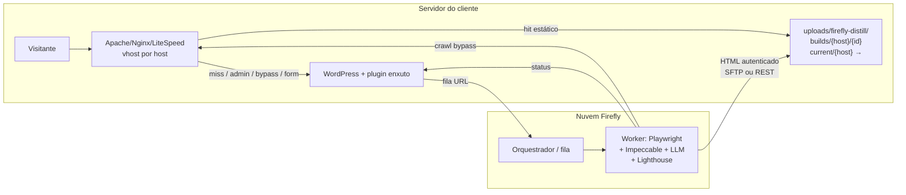

# firefly-distill — Documento de Projeto + Roadmap

| Campo | Valor |
|-------|-------|
| **Nome** | firefly-distill |
| **Tipo** | Plugin Firefly para melhoria de SEO/GEO (ferramenta **interna**) |
| **Empresa** | Quatro Ventos / Firefly |
| **Autor** | Gabriel Roloff |
| **Versão do doc** | 2.2 |
| **Data** | 2026-11-06 (America/Sao_Paulo) |
| **Status** | Seed para implementação (Cursor + skill Impeccable) |
| **Idioma** | pt-BR |
| **Doc irmão** | `CURSOR.md` (brief de implementação) |

> **Novo na v2.2:** landing pages **multi-host** (caso Incavel) — várias LPs no mesmo WP, cada uma respondendo como site próprio via vhost + reverse proxy; manifesto/disco **por host** (`current/{host}/…`); `robots.txt`, `sitemap.xml` e `llm.txt` próprios por host; tela de **mapeamento** página/post → domínio público no wp-admin; dashboard/OpenSEO por hostname. Ver **§7**.

> **Não é produto à venda.** Sem planos, créditos para cliente, marketplace ou trial público. O custo de LLM/infra é da operação Firefly e fica embutido no contrato de SEO/GEO que o cliente já tem com Gabriel.

---

## 1. Visão e para quem é (interno SEO/GEO)

### Problema

Sites WordPress institucionais dos clientes de SEO/GEO da Quatro Ventos / Firefly costumam chegar com front inchado: page builders (Elementor, Divi, Bricks), stacks de otimização empilhadas e HTML pesado. O resultado típico é Lighthouse Performance mobile baixo, TTFB alto e sinais fracos para SEO/GEO — mesmo com conteúdo editorial correto.

O wp-admin precisa continuar existindo (conteúdo, formulários, Yoast/Rank Math, etc.). O que dói é o **runtime do visitante**.

### Visão

**firefly-distill** é uma ferramenta **interna** da operação Firefly: um plugin WordPress enxuto no servidor do cliente + um agente na **nuvem Firefly** (estilo OpenCode + skill **Impeccable**) que:

1. Descobre URLs públicas a partir do WordPress (fonte da verdade)
2. Crawla a origem com **bypass** (para não ler o estático velho)
3. Destila o design system e regenera cada página em **HTML/CSS puro**
4. Aplica regras SEO/GEO on-page + loop Lighthouse
5. **Grava o HTML no disco do cliente** e a rewrite do Apache/Nginx/LiteSpeed serve esse arquivo **antes** do WordPress subir
6. Mantém um **dashboard** com PageSpeed (Lighthouse/PSI) e SEO de **todas** as páginas (não só a home), vinculado ao **OpenSEO** (projeto/conta do cliente)
7. Suporta **landing pages multi-host** (Incavel): várias LPs do mesmo WP, cada uma com domínio público, pasta, `robots.txt`, `sitemap.xml` e `llm.txt` próprios, mapeadas no wp-admin
8. Usa IA para ler origem WP + HTML destilado + dados OpenSEO + Lighthouse por URL e **sugerir melhorias** num backlog revisável pela equipe Firefly

O visitante recebe arquivo estático. PHP/WP **não sobe** se o `index.html` existir. Forms, busca e área logada continuam no WordPress.

### Para quem é

| Persona | Papel |
|---------|-------|
| **Equipe Firefly / Gabriel** | Opera o distill nos sites que já têm contrato de SEO/GEO |
| **Cliente contratado** | Não compra o plugin; recebe o benefício como parte do serviço |
| **Dev implementador** | Usa este doc + monorepo como seed no Cursor |

**Fora de escopo comercial:** loja, planos, créditos por página para o cliente, trial público, marketplace de temas.

---

## 2. Por que não headless React

Decisão explícita: **não** usar WordPress headless + React (ou Next/Astro/etc.) como front do visitante.

| Abordagem | Por que rejeitada / aceita |
|-----------|----------------------------|
| WP headless + React/Next | Complexidade de deploy, hidratação, JS bundle, custo de manutenção por cliente, acoplamento a Node no edge. Não entrega o “arquivo morto no disco”. |
| Cache plugin (WP Rocket, etc.) | Continua rodando PHP + tema + builders; não reconstrói o HTML. |
| **HTML/CSS puro gravado no servidor** | Visitante = `try_files` / `RewriteCond` → arquivo. Zero PHP no hit. Rollback = symlink. Portável em Apache, Nginx e LiteSpeed. |

O front do visitante é **só** HTML + CSS (+ JS mínimo se necessário, ex. menu mobile com `defer`). Sem React, sem hidratação, sem SSR Node.

---

## 3. Escopo MVP / Fase 2 / Fora

### MVP (Fase 1)

| Inclui | Detalhe |
|--------|---------|
| Sites institucionais | Landing / páginas / posts públicos; **≤ 50 páginas** |
| HTML/CSS puro no disco | Caminho sob `wp-content/uploads/firefly-distill/` |
| Serve antes do WP | Apache / Nginx / LiteSpeed `try_files` ou `RewriteCond` |
| Bypass de origem | Cookie ou query assinada `?firefly-distill=origin` |
| Incremental | Hooks WP só **enfileiram** URL; agente regenera só o que mudou |
| Publicação atômica | `builds/{id}` + symlink `current`; rollback = voltar symlink |
| Forms / busca / logados | Continuam no WP (exclusões de rewrite) |
| Relatório Lighthouse / PSI | Scores de **todas** as URLs do site (origem e build), não só a home |
| Dashboard OpenSEO | Vínculo com `openseo_project_id` do cliente: Search Console, keywords, indexação, oportunidades cruzados com scores por URL |
| Sugestões IA (MVP) | Tabela de scores por página + lista de sugestões revisáveis (backlog Firefly) |
| **LPs multi-host (Incavel)** | Mapeamento post/página → host público no wp-admin; disco `current/{host}/`; `try_files` por `$host` antes do `proxy_pass`; `robots.txt` / `sitemap.xml` / `llm.txt` por host; incremental por host |
| Plugin enxuto | Listar URLs, fila, receber HTML autenticado, serve on/off, rollback, exclusões, espelho de audits/sugestões |

### Fase 2

- **Aplicar sugestão em um clique** (editar WP + rebuild incremental, ou patch técnico no HTML estático)
- Mapeamento host→página feito pelo próprio plugin (substituir o proxy/rewrite atual da Incavel), se fizer sentido
- Multilíngue (WPML/Polylang) com hreflang completo no estático
- Detecção mais rica de LocalBusiness / FAQ schema
- Workers paralelos por site; fila prioritária interna
- LiteSpeed-specific helpers documentados além de Apache/Nginx
- Diff visual automatizado (screenshot + pixel) no painel interno
- Rebuild noturno programado (cron nuvem) além dos hooks
- Reauditoria automática pós-apply + fechamento de sugestão no OpenSEO

### Fora (MVP e produto)

- WooCommerce checkout / carrinho / conta
- Sites com área de membros no front como produto
- Multisite network-wide (multi-host aqui = **um** WP com vários domínios mapeados, não WP Multisite)
- Planos, créditos para cliente, trial público, marketplace
- WordPress headless + React
- Rodar LLM / Playwright / Impeccable **dentro do PHP do cliente**
- Clonar sites de terceiros

---

## 4. Arquitetura

### Fluxo do visitante

```
Visitante
   │
   ▼
Apache / Nginx / LiteSpeed  (vhost por host / reverse proxy)
   │  try_files / RewriteCond por Host
   │  arquivo existe em current/{host}/{path}/index.html?
   ├─ SIM + não exclusão → serve HTML do disco (PHP/WP NÃO sobe)
   └─ NÃO / exclusão / bypass / logado / POST → proxy_pass / WordPress (PHP)
```

### Fluxo de geração (incremental)

```
WordPress (fonte da verdade)
   │  hooks: save_post, menu update, etc.
   ▼
Plugin enxuto → resolve (host, path) via mapeamento → enfileira na nuvem Firefly
   │
   ▼
Nuvem: job + worker
   Playwright (crawl no host público com bypass)
   + skill Impeccable (destilação)
   + LLM (geração HTML/CSS)
   + Lighthouse CI (loop ≤ 3)
   │
   ▼
Grava HTML no servidor do cliente
   (SFTP ou REST autenticada do plugin: receive-build)
   builds/{host}/{id}/…  →  symlink atômico current/{host}
   (+ robots.txt, sitemap.xml, llm.txt do host)
```

### Diagrama



### Fluxo dashboard + OpenSEO + agente de sugestões

```
Nuvem Firefly
  │  após build (ou job audit periódico)
  ├─ Lighthouse/PSI por URL (todas as páginas do manifesto ≤50)
  ├─ Sync OpenSEO (projeto do cliente: GSC, keywords, indexação, oportunidades)
  └─ Agente IA
        inputs: HTML origem (bypass) + HTML destilado + page_audits + OpenSEO por URL
        output: suggestions[] (título, H1/Hn, conteúdo SEO/GEO, internas, schema, imagens, CLS…)
              → backlog revisável no admin / nuvem (equipe Firefly)
MVP: ver scores + aceitar/rejeitar/adiar sugestões.
Fase 2: “Aplicar” → editar WP + enqueue rebuild  |  ou ajuste técnico no HTML.
```

O vínculo é por site e, quando existir propriedade GSC própria, **por host** (`hosts.openseo_project_id`); senão herda o do site: `openseo_project_id` na nuvem (e espelhado nas settings do plugin). OpenSEO continua sendo a fonte de Search Console / keywords / oportunidades; firefly-distill agrega **PageSpeed + SEO on-page por URL** e alimenta o agente.

### Papéis

| Camada | Responsabilidade |
|--------|------------------|
| **Rewrite / reverse proxy** | Servir `current/{host}/…` **antes** do `proxy_pass`/PHP, escolhendo a pasta pelo `Host` (allowlist) |
| **Plugin WP** | Mapeamento post→host (UI), descobrir URLs, enfileirar mudanças, receber build, helpers de rewrite, on/off, rollback, exclusões |
| **Nuvem Firefly** | Jobs, workers, Playwright, Impeccable, LLM, Lighthouse, empacote e entrega |
| **Disco do cliente** | Única fonte servida ao visitante após ativação |
| **OpenSEO** | Projeto/conta do cliente: GSC, keywords, indexação, oportunidades; cruzado com `page_audits` |
| **Agente de sugestões** | Lê origem + destilado + OpenSEO + Lighthouse → backlog `suggestions` |

**Custo LLM/infra:** conta Firefly; embutido no contrato SEO/GEO. Cliente não vê créditos.

---

## 5. Rewrite concreto

Caminho canônico no disco (**v2.2: por host**):

```
wp-content/uploads/firefly-distill/current/{host}/{path}/index.html
```

Exemplos:

| Host + path público | Arquivo |
|---------------------|---------|
| `incavel.com.br/` | `.../current/incavel.com.br/index.html` |
| `incavel.com.br/sobre/` | `.../current/incavel.com.br/sobre/index.html` |
| `lp-consorcio.exemplo.com.br/` (post raiz mapeado) | `.../current/lp-consorcio.exemplo.com.br/index.html` |
| `lp-consorcio.exemplo.com.br/robots.txt` | `.../current/lp-consorcio.exemplo.com.br/robots.txt` |

Assets do build de cada host: `.../current/{host}/assets/` (CSS, imagens otimizadas, JS mínimo). `robots.txt`, `sitemap.xml` e `llm.txt` ficam na raiz da pasta do host.

> Os snippets abaixo (v2.1) mostram o caso **single-host** e continuam válidos trocando `current/` por `current/{host}/`. Para LPs multi-host com reverse proxy, usar os snippets de **§7.4 / §7.5** (`try_files` por `$host` antes do `proxy_pass`).

### Exclusões (nunca servir estático)

- `wp-admin`, `wp-login.php`, `wp-json`, `xmlrpc.php`
- Preview (`preview=true`, `p=` com auth)
- Usuário **logado** (cookie `wordpress_logged_in_*`)
- Métodos que não sejam `GET`/`HEAD` (forms **POST** → WP)
- Query de bypass: `firefly-distill=origin` (assinada) ou cookie de bypass
- Paths na allowlist de exclusão do plugin (busca, account, etc.)

### Apache (exemplo comentado)

```apache
# firefly-distill — servir HTML estático ANTES do WordPress
# Colocar em .htaccess (antes das regras padrão do WP) ou vhost.

<IfModule mod_rewrite.c>
  RewriteEngine On

  # 1) Nunca interceptar admin / login / API / cron
  RewriteRule ^wp-admin/ - [L]
  RewriteRule ^wp-login\.php$ - [L]
  RewriteRule ^wp-json/ - [L]
  RewriteRule ^xmlrpc\.php$ - [L]

  # 2) Bypass de origem (crawl do worker) — query assinada
  #    ?firefly-distill=origin  → cai no WP (não servir estático)
  RewriteCond %{QUERY_STRING} (^|&)firefly-distill=origin(&|$) [NC]
  RewriteRule .* - [L]

  # 3) Cookie de bypass (alternativa ao query)
  RewriteCond %{HTTP_COOKIE} firefly_distill_bypass=1 [NC]
  RewriteRule .* - [L]

  # 4) Usuário logado → WP (cookie wordpress_logged_in_*)
  RewriteCond %{HTTP_COOKIE} wordpress_logged_in_ [NC]
  RewriteRule .* - [L]

  # 5) Só GET/HEAD
  RewriteCond %{REQUEST_METHOD} !^(GET|HEAD)$ [NC]
  RewriteRule .* - [L]

  # 6) Se existir index.html no current/{path}/ → servir
  #    DocumentRoot = raiz do WP. Ajuste o caminho se uploads for externo.
  #    v2.2: inserir %{HTTP_HOST} após current/ (ver §7.5)
  RewriteCond %{DOCUMENT_ROOT}/wp-content/uploads/firefly-distill/current/%{HTTP_HOST}/$1/index.html -f
  RewriteRule ^(.*)$ /wp-content/uploads/firefly-distill/current/%{HTTP_HOST}/$1/index.html [L]

  # Home: / → current/index.html
  RewriteCond %{REQUEST_URI} ^/$ 
  RewriteCond %{DOCUMENT_ROOT}/wp-content/uploads/firefly-distill/current/%{HTTP_HOST}/index.html -f
  RewriteRule ^$ /wp-content/uploads/firefly-distill/current/%{HTTP_HOST}/index.html [L]
</IfModule>

# Em seguida: regras padrão do WordPress (index.php fallback)
```

### Nginx (exemplo comentado)

```nginx
# firefly-distill — try_files no location / (antes do fallback WP)

# Mapa: cookie logado ou bypass → sinaliza "ir para WP"
map $http_cookie $ff_skip_static {
    default                 0;
    ~*wordpress_logged_in_  1;
    ~*firefly_distill_bypass=1  1;
}

# v2.2: o parâmetro tem hífen (firefly-distill), então $arg_ não funciona — usar regex em $args
map $args $ff_origin_bypass {
    default  0;
    "~(^|&)firefly-distill=origin(&|$)"  1;
}

server {
    # ... root, ssl, etc.

    # Admin / API nunca estáticos
    location ^~ /wp-admin/ { try_files $uri $uri/ /index.php?$args; }
    location = /wp-login.php { include fastcgi_params; /* … */ }
    location ^~ /wp-json/ { try_files $uri /index.php?$args; }

    location / {
        # POST/PUT/etc. → WP
        if ($request_method !~ ^(GET|HEAD)$) { rewrite ^ /index.php last; }

        # Bypass crawl ou logado → WP
        if ($ff_skip_static = 1) { rewrite ^ /index.php last; }
        if ($ff_origin_bypass = 1) { rewrite ^ /index.php last; }

        # Tenta HTML estático; senão WP
        # $uri /  →  …/current{uri}/index.html
        set $ff_html /wp-content/uploads/firefly-distill/current/$host${uri}/index.html;  # v2.2: por host (ideal: $ff_host_dir da allowlist, §7.4)
        # Home: uri=/ → current/index.html (normalizar barra)
        if ($uri = /) {
            set $ff_html /wp-content/uploads/firefly-distill/current/$host/index.html;
        }

        try_files $ff_html $uri $uri/ /index.php?$args;
    }
}
```

> **Nota:** em Nginx, `if` é delicado; em produção preferir `map` + `try_files` com root auxiliar ou `alias` apontando para `current/`. O plugin deve documentar o snippet testado por stack (Apache / Nginx / LiteSpeed).

### Bypass (crawl de origem)

A fonte da verdade é o **WordPress**. Para o worker não ler o HTML estático antigo:

1. **Query assinada (preferida):** `https://{host}/sobre/?firefly-distill=origin&ff_sig=…&ff_exp=…`  
   - Assinatura HMAC com segredo do site sobre `host + path + exp`; TTL curto.  
   - Pedida **no host público correto** (LP → domínio da LP), para o reverse proxy cair no WP pelo mesmo caminho do visitante.  
   - Rewrite vê `firefly-distill=origin` e **não** serve o estático.
2. **Cookie de bypass:** `firefly_distill_bypass=1` (HttpOnly, Secure, TTL curto), setado só pelo fluxo autenticado do worker.

Sem bypass, um rebuild incremental leria o próprio output e “congelaria” o conteúdo.

### Cookie logado

Qualquer request com `wordpress_logged_in_*` cai no WP. Assim o editor vê o tema real; o visitante anônimo vê o estático.

---

## 6. Layout de arquivos no servidor do cliente

> **v2.2:** o layout abaixo vale **dentro de cada host**. Layout completo multi-host (com `builds/{host}/{id}/`, `current/{host}` symlink por host, `robots.txt`, `sitemap.xml`, `llm.txt`) em **§7.2**. Site sem LPs = um único host.

```
wp-content/uploads/firefly-distill/
  builds/
    20261106T133000Z-a1b2/          # build imutável
      index.html                    # home
      sobre/
        index.html
      blog/
        meu-post/
          index.html
      assets/
        site.css
        img/
          hero.avif
          logo.webp
      robots.txt                    # v2.2: por host
      sitemap.xml                   # v2.2: por host
      llm.txt                       # v2.2: por host
      manifest.json                 # host, urls, post_id, hashes, post_modified
      lighthouse-summary.json
    20261105T100000Z-c3d4/          # build anterior (retenção)
  current -> builds/20261106T133000Z-a1b2/   # SYMLINK atômico
```

**Publicação atômica**

1. Worker/plugin grava tudo em `builds/{id}/` (completo).
2. Valida manifest + checksums.
3. `ln -sfn builds/{id} current.tmp && mv -Tf current.tmp current` (ou equivalente atômico).
4. Visitantes passam a ver o novo build sem janela a meio caminho.

**Rollback**

- Apontar `current` de volta para o `builds/{id}` anterior.
- Ou desligar “serve estático” no plugin (rewrite deixa de achar / flag off) → tudo cai no WP.

**Retenção:** manter N builds locais (ex. 5); purge dos mais antigos pela equipe Firefly / job do plugin.

---

## 7. Landing pages multi-host (Incavel)

> **Novo na v2.2.** Caso-base: **Incavel** — um único WordPress (site mãe) hospeda várias landing pages; cada LP responde como **site próprio** num domínio público diferente, via **vhost + reverse proxy** na frente do WP.

### 7.1 Modelo

| Conceito | Definição |
|----------|-----------|
| **Site** | 1 instalação WP com o plugin firefly-distill (ex.: WP da Incavel) |
| **Host** | Domínio público que o visitante digita (ex.: `incavel.com.br`, `lp-consorcio.exemplo.com.br`). O site mãe também é um host |
| **Mapeamento** | `host` → `post_id` raiz (página/post WP que responde em `https://{host}/`) + rotas extras opcionais (`/obrigado/`, `/politica/` …) |
| **Permalink interno** | URL que o WP conhece (ex.: `https://incavel.com.br/lp/consorcio-x/`) — **não** é a URL pública da LP |
| **URL pública** | `https://{host}{path}` — é a que vai para canonical, sitemap, OpenSEO e dashboard |

Regras:

1. **Manifesto e disco são por HOST**, não só por permalink: chave da página = `(host, path)`. Caminho servido: `current/{host}/{path}/index.html`.
2. O **reverse proxy faz `try_files` por `Host` ANTES** do `proxy_pass`/PHP. Hit = arquivo do host; miss = segue o fluxo atual (proxy → WP).
3. Cada host tem **pasta própria** com `robots.txt`, `sitemap.xml` e `llm.txt` **próprios**. Nada é herdado do site mãe nem do sitemap global do Yoast/Rank Math.
4. **Forms da LP continuam no WP**: POST (e qualquer método ≠ GET/HEAD) nunca bate no estático; o `action` do form aponta para uma rota POST tratada pelo WP (`admin-ajax.php`, `wp-json/…` do plugin de form, ou a própria URL com POST → proxy).
5. Mapeamento é **configurado no wp-admin** (tela de mapeamento — §15, item 2) e espelhado na nuvem.
6. O mecanismo atual que faz o vhost da LP chegar na página certa do WP (proxy/rewrite host→página existente na Incavel) **não é substituído** no MVP; o distill só se encaixa **antes** dele.

### 7.2 Layout de disco por host

```
wp-content/uploads/firefly-distill/
  builds/
    incavel.com.br/
      20261106T133000Z-a1b2/
        index.html
        sobre/index.html
        robots.txt
        sitemap.xml
        llm.txt
        assets/site.css
        manifest.json            # host, rotas, post_id, hashes, post_modified_gmt
        lighthouse-summary.json
    lp-consorcio.exemplo.com.br/
      20261106T140500Z-e5f6/
        index.html               # = post_id raiz mapeado
        obrigado/index.html      # rota extra opcional
        robots.txt               # próprio do host
        sitemap.xml              # só URLs deste host
        llm.txt                  # resumo GEO deste host
        assets/site.css
        manifest.json
  current/                       # diretório real (não symlink)
    incavel.com.br              -> ../builds/incavel.com.br/20261106T133000Z-a1b2
    lp-consorcio.exemplo.com.br -> ../builds/lp-consorcio.exemplo.com.br/20261106T140500Z-e5f6
  hosts.map.conf                 # gerado pelo plugin: allowlist host → dir (include Nginx)
```

- **Publicação atômica por host:** `ln -sfn ../builds/{host}/{id} current/{host}.tmp && mv -Tf current/{host}.tmp current/{host}`. Rebuild de uma LP **não** toca os outros hosts.
- **Rollback por host:** reapontar só `current/{host}`.
- **Site sem LPs** (caso v2.1): existe um único host = host de `home_url()`; layout idêntico, só com uma entrada em `current/`.
- Nome da pasta = host normalizado (minúsculo, sem porta, sem `www.` só se o mapeamento disser que `www` redireciona). Regex de validação: `^[a-z0-9.-]+$`.

### 7.3 robots.txt / sitemap.xml / llm.txt por host

| Arquivo | Gerado de | Conteúdo mínimo |
|---------|-----------|-----------------|
| `robots.txt` | flags do host | `flag_robots_index=1` → `User-agent: *` / `Allow: /` / `Sitemap: https://{host}/sitemap.xml`. `=0` → `Disallow: /` |
| `sitemap.xml` | rotas mapeadas do host com `in_sitemap=1` | `<loc>https://{host}{path}</loc>` + `<lastmod>` = `post_modified_gmt`. **Nunca** inclui URLs de outro host nem permalinks internos |
| `llm.txt` | flag `flag_llm_txt` + conteúdo da LP | Markdown curto: nome/oferta, para quem, região, contato/CTA, lista de URLs públicas do host. Opcional: servir também em `/llms.txt` (alias) |

- Gerados **na nuvem** a cada job do host e entregues no mesmo `builds/{host}/{id}/` (republicados junto com o HTML).
- No host da LP, `/sitemap_index.xml`, `/*-sitemap.xml` e `/wp-sitemap.xml` (Yoast/Rank Math/core) → **404** ou 301 para `/sitemap.xml` do host — não vazar o sitemap global.
- No site mãe: os `post_id` mapeados para outro host saem do sitemap global (ex.: filtro `wpseo_exclude_from_sitemap_by_post_ids` no Yoast; equivalente no Rank Math) e o permalink interno emite canonical para `https://{host}/`. 301 do permalink interno só se o proxy da LP **não** depender dele.

### 7.4 Nginx — `try_files` por `$host` antes do `proxy_pass`/PHP

```nginx
# /etc/nginx/conf.d/firefly-distill-maps.conf  (contexto http)

# Allowlist host → pasta (gerado pelo plugin: uploads/firefly-distill/hosts.map.conf)
map $host $ff_host_dir {
    default "";
    include /var/www/incavel/wp-content/uploads/firefly-distill/hosts.map.conf;
    # linhas geradas, ex.:
    # incavel.com.br               incavel.com.br;
    # lp-consorcio.exemplo.com.br  lp-consorcio.exemplo.com.br;
}

# Bypass por query (?firefly-distill=origin) — nome com hífen não vira $arg_, então regex em $args
map $args $ff_q_bypass {
    default 0;
    "~(^|&)firefly-distill=origin(&|$)" 1;
}

map $http_cookie $ff_c_skip {
    default 0;
    "~*wordpress_logged_in_"       1;
    "~*firefly_distill_bypass=1"   1;
}

# 1 = pode tentar estático
map "$request_method:$ff_q_bypass:$ff_c_skip:$ff_host_dir" $ff_static {
    default 0;
    "~^(GET|HEAD):0:0:.+$" 1;
}

upstream wp_origin { server 127.0.0.1:8080; }   # WP da Incavel (Apache/PHP-FPM atrás)
```

```nginx
# vhost de UMA landing page (repetir por host, ou server_name com lista)
server {
    listen 443 ssl http2;
    server_name lp-consorcio.exemplo.com.br;
    # ssl_certificate ...;

    set $ff_root /var/www/incavel/wp-content/uploads/firefly-distill;

    # Admin/API/forms nunca estáticos
    location ~ ^/(wp-admin|wp-json|wp-login\.php|xmlrpc\.php|wp-cron\.php|wp-content/plugins) {
        proxy_pass http://wp_origin;
        include /etc/nginx/snippets/ffd-proxy-headers.conf;
    }

    # Sitemaps globais do WP não vazam na LP
    location ~ ^/(sitemap_index\.xml|wp-sitemap.*\.xml|[a-z0-9_-]+-sitemap[0-9]*\.xml)$ {
        return 301 https://$host/sitemap.xml;
    }

    location / {
        error_page 418 = @wp;
        if ($ff_static = 0) { return 418; }     # POST, bypass, logado, host fora da allowlist

        root $ff_root;
        # robots.txt, sitemap.xml, llm.txt, assets → arquivo; / e /path/ → index.html
        try_files /current/$ff_host_dir$uri
                  /current/$ff_host_dir${uri}index.html
                  /current/$ff_host_dir$uri/index.html
                  @wp;
    }

    location @wp {
        # fluxo atual da Incavel: o proxy leva a LP até a página certa do WP
        proxy_pass http://wp_origin;
        include /etc/nginx/snippets/ffd-proxy-headers.conf;
    }
}
```

```nginx
# /etc/nginx/snippets/ffd-proxy-headers.conf
proxy_set_header Host              $host;
proxy_set_header X-Forwarded-Host  $host;
proxy_set_header X-Forwarded-Proto $scheme;
proxy_set_header X-Forwarded-For   $proxy_add_x_forwarded_for;
proxy_set_header X-Real-IP         $remote_addr;
```

- `$ff_host_dir` vem de **allowlist** (map), nunca do `Host` cru → sem path traversal via header.
- `robots.txt`/`sitemap.xml`/`llm.txt` são servidos **pela primeira linha** do `try_files`; se a pasta do host não tiver o arquivo, cai no WP (só acontece antes do 1º build).
- Se o upstream for PHP-FPM direto (site mãe no mesmo Nginx), `@wp` vira `try_files $uri $uri/ /index.php?$args;` + `location ~ \.php$` padrão.
- `Cache-Control` para HTML estático: curto (`max-age=300`), assets com hash: longo.

### 7.5 Apache (vhost da LP, equivalente)

```apache
# Antes do ProxyPass / regras WP
RewriteEngine On
RewriteCond %{REQUEST_METHOD} ^(GET|HEAD)$
RewriteCond %{QUERY_STRING} !(^|&)firefly-distill=origin(&|$)
RewriteCond %{HTTP_COOKIE} !(wordpress_logged_in_|firefly_distill_bypass=1)
RewriteCond %{REQUEST_URI} !^/(wp-admin|wp-json|wp-login\.php|xmlrpc\.php)
RewriteCond %{HTTP_HOST} ^([a-z0-9.-]+)$ [NC]
RewriteCond /var/www/incavel/wp-content/uploads/firefly-distill/current/%1%{REQUEST_URI}index.html -f
RewriteRule ^ /var/www/incavel/wp-content/uploads/firefly-distill/current/%1%{REQUEST_URI}index.html [L]
# (regras análogas para robots.txt / sitemap.xml / llm.txt sem "index.html")
ProxyPass        / http://127.0.0.1:8080/
ProxyPassReverse / http://127.0.0.1:8080/
```

> Apache: o host passa por regex `^[a-z0-9.-]+$`; preferir `RewriteMap` com allowlist gerada pelo plugin quando o painel permitir.

### 7.6 Crawl de origem multi-host

- O worker pede `https://{host}{path}?firefly-distill=origin&ff_sig=…&ff_exp=…` **no host público** (mesma rota do visitante), com `Host: {host}` correto → o proxy cai em `@wp` (bypass) e entrega o HTML real do WP para aquela LP.
- Assinatura HMAC cobre `host + path + exp` (token de um host não vale em outro).
- Allowlist de crawl = hosts **mapeados** e ativos (não só `home_url()`).
- Fallback (se DNS do host ainda não aponta): crawl no permalink interno com header `Host` forçado + `--resolve`/`hostResolverRules` do Chromium para o IP da origem.

### 7.7 Incremental por host

1. `save_post` do `post_id` X → plugin resolve **quais hosts** usam X (raiz ou rota extra) → enfileira `(host, path)`.
2. Nuvem abre job `scope=host`, `host=…`, `paths=[…]` (debounce 60s por host).
3. Worker crawla só aquelas rotas (bypass), regenera HTML e **sempre** regenera `robots.txt`, `sitemap.xml` (lastmod), `llm.txt` do host.
4. Entrega em `builds/{host}/{novo_id}/` (cópia do build anterior do host + arquivos novos; ≤ dezenas de arquivos) → symlink `current/{host}`.
5. Audit Lighthouse/PSI só das URLs do host afetado; sugestões só desse host.
6. Mudança de **flags** (robots/sitemap/llm/estático) na tela de mapeamento → job `scope=host_meta` (sem crawl de HTML se só flags mudaram; republica os 3 arquivos).
7. Mudança de menu/footer global → enfileira **todos** os hosts que usam o tema (debounce).

### 7.8 Dashboard e OpenSEO por hostname

- Dashboard tem **seletor de host** (default: todos, agrupado por host). Tabela por URL usa a **URL pública** `https://{host}{path}` e mostra o permalink interno em cinza.
- `openseo_project_id` **por host quando existir** (propriedade GSC própria, ex.: `sc-domain:lp-consorcio.exemplo.com.br`); senão herda o projeto do site mãe e filtra pelo hostname.
- Cruzamento OpenSEO ↔ `page_audits` por `(host, path)` normalizado.
- Sugestões IA levam `host`; backlog filtrável por host.

### 7.9 UI wp-admin — Mapeamento página/post → domínio público

Tela **firefly-distill → Hosts / Mapeamento** (capability `manage_options`):

| Elemento | Comportamento |
|----------|---------------|
| Lista de hosts | Colunas: host público, https, post raiz (título + ID), **permalink interno vs URL pública**, flags robots / sitemap / llm.txt, estático on/off, último build, scores médios, OpenSEO vinculado |
| Adicionar/editar | Campo host (validação `^[a-z0-9.-]+$`, sem esquema), toggle https (default on), **busca de página/post por título** (autocomplete AJAX em `page`/`post`/CPTs públicos), rotas extras (path → post_id), flags |
| Flags | `flag_robots_index`, `flag_sitemap`, `flag_llm_txt`, `static_enabled` |
| OpenSEO | `openseo_project_id` (opcional; vazio = herda do site) e `gsc_property` |
| Ações por linha | Testar host (HEAD público + bypass), Rebuild host, Rollback host, Ver robots/sitemap/llm.txt publicados, Copiar snippet Nginx/Apache |
| **Import opcional** | Upload/colar CSV `host,post_id[,path][,https][,robots][,sitemap][,llm][,static]` → preview com validação (host duplicado, post inexistente) → confirmar |
| Export | Gera `hosts.map.conf` e CSV atual |

Regras: host único por site; um `post_id` pode ser raiz de só **um** host (rotas extras podem repetir com aviso); desligar `static_enabled` remove a entrada de `hosts.map.conf` (tudo cai no WP) sem apagar builds.

---

## 8. Pipeline incremental

### Princípio

O agente **só regenera páginas que mudaram** — e, em multi-host, **só o host afetado** (+ `robots.txt`/`sitemap.xml`/`llm.txt` dele; ver §7.7). Hooks do WordPress **nunca** geram HTML; só enfileiram a URL (ou um lote) na nuvem.

### Detecção de mudança

| Sinal | Uso |
|-------|-----|
| `save_post` / `deleted_post` / `transition_post_status` | Enfileira permalink da post/page |
| `wp_update_nav_menu` / widgets / customizer relevantes | Enfileira páginas afetadas (ou “rebuild header/footer partials” + páginas que incluem) |
| `post_modified_gmt` + hash de conteúdo | Comparar com `manifest.json` do `current` |
| Hash do HTML de origem (após bypass) | Confirma se a origem mudou de verdade |

### Fluxo de 1 página

1. Hook → plugin resolve hosts via mapeamento e registra `host`, `path`, `url`, `post_id`, `reason`, `enqueued_at` na tabela local + `POST` para a fila nuvem.
2. Nuvem abre job **page-scoped** (ou batch debounce 30–60s).
3. Worker faz GET no **host público** com **bypass** → HTML/CSSOM/screenshot de origem.
4. Compara hash origem vs. último processado; se igual e estático ok → no-op.
5. Destila (reusa `design-tokens.json` do site se ainda válido) → gera HTML/CSS da página.
6. SEO pass + Lighthouse na URL.
7. Entrega via REST `receive-build` (arquivo(s) da página + assets novos) ou SFTP no `builds/{id}` em construção.
8. Quando o lote fecha: publica symlink `current` (ou hot-swap só dos arquivos da página dentro do build ativo — MVP preferir build novo completo se ≤50 páginas; hot-swap arquivo a arquivo na Fase 2).

### Debounce

Vários `save_post` em sequência → uma única janela de job (ex. 60s) **por host** para não disparar 10 workers.

### Origem vs estático

Sempre comparar **origem (bypass)** com o que está em `current/`. Nunca usar o estático como input de regeneração.

---

## 9. Destilação Impeccable + regras SEO/Lighthouse

### Destilação (skill Impeccable)

| Categoria | Output |
|-----------|--------|
| Cores | `--color-*` (primária, neutros, fundo, texto, feedback) |
| Tipografia | Famílias, escala, pesos, line-height → `--font-*`, `--text-*` |
| Espaçamento | Escala 4/8 → `--space-*` |
| Raios / sombra | `--radius-*`, `--shadow-*` |
| Componentes | Header, nav, hero, card, button, form, footer — markup semântico |
| Breakpoints | `--bp-md`, `--bp-lg` |

Arquivos canônicos no build: `design-tokens.json` + `assets/site.css`.

**Como o HTML deve ficar**

- CSS com custom properties; **sem** utility soup / CSS de page builder
- Sem jQuery obrigatório; sem JS de Elementor/Divi
- Layout flex/grid; mobile-first
- `font-display: swap`; self-host quando possível
- Animações pesadas → simplificar ou CSS mínimo
- 1 CSS global; 1 HTML por página

### SEO / GEO on-page

| Item | Regra |
|------|-------|
| `<title>` | Único; ~≤60 chars |
| meta description | Única; ~150–160 |
| H1 | Exatamente um |
| Headings | Hierarquia lógica |
| Canonical | Absoluto self **na URL pública** `https://{host}{path}` (nunca o permalink interno) |
| robots | Respeitar noindex da origem; em LP, `flag_robots_index` do host prevalece |
| Images | `alt`, `width`, `height`, `loading="lazy"` (exceto LCP) |
| LCP | `preload` do hero |
| Schema JSON-LD | Organization, WebSite, Article; LocalBusiness se detectado |
| OG / Twitter | title, description, image |
| Critical CSS | Inline pequeno no `<head>` |
| GEO | Conteúdo factual claro, entidades, FAQ se existir na origem |

### Thresholds Lighthouse (aceite do build)

| Categoria | Target |
|-----------|--------|
| Performance (mobile) | ≥ 90 |
| SEO | ≥ 95 |
| Accessibility | ≥ 90 |
| Best Practices | ≥ 95 |

Falha → loop de correção ≤ 3 → se ainda falhar: `completed_with_warnings` (equipe decide ativar ou não).

---

## 10. Dashboard OpenSEO + agente de sugestões

### Objetivo

Dar à equipe Firefly um painel único por site cliente, **com seletor por hostname** (LPs multi-host):

1. **PageSpeed (Lighthouse / PageSpeed Insights)** de **todas** as páginas do manifesto (não só a home)
2. **SEO on-page / GEO** por URL (title, H1, schema, imagens, CLS-related, etc.)
3. Dados do **OpenSEO** do projeto do cliente (Search Console, keywords, indexação, oportunidades) **cruzados** com os scores por URL
4. **Sugestões de IA** priorizadas, revisáveis, com trilha de apply na Fase 2

### Dashboard (MVP)

| Bloco | Conteúdo |
|-------|----------|
| Resumo do site | Médias Performance / SEO / A11y / BP; delta origem vs build; status serve |
| Seletor de host | Todos / site mãe / cada LP; médias por host |
| Tabela por URL | Todas as páginas ≤50 (URL pública + permalink interno): scores LH/PSI (mobile), flags SEO, impressões/cliques/posição (GSC via OpenSEO se houver), status de indexação, nº de sugestões abertas |
| Detalhe da URL | Scores before/after, top opportunities Lighthouse, snippet OpenSEO (queries, cobertura), HTML origem vs destilado (links) |
| Backlog de sugestões | Lista filtrável: severidade, URL, categoria, status (open / accepted / rejected / applied / deferred) |

### Vínculo OpenSEO

- Cada site firefly-distill aponta para um **`openseo_project_id`** (conta/projeto do cliente na operação Firefly).
- Sync periódico (ou pós-job) puxa: propriedades Search Console, keywords/queries, estado de indexação/cobertura, oportunidades já existentes no OpenSEO.
- Cruzamento por **URL canônica pública** `(host, path)` (normalizar trailing slash / home).
- **Por host:** `openseo_project_id` / propriedade GSC próprios quando a LP tiver; senão herda o do site e filtra por hostname.
- Oportunidades OpenSEO podem virar ou enriquecer `suggestions` (dedupe por hash de título+URL+categoria).

### Agente de IA — inputs e outputs

**Lê (por URL ou lote):**

- HTML de origem (crawl com bypass)
- HTML destilado atual (`current/`)
- `page_audits` (scores + audits Lighthouse/PSI)
- Fatia OpenSEO da URL / site (GSC, keywords, indexação, oportunidades)

**Sugere melhorias em categorias:**

| Categoria | Exemplos |
|-----------|----------|
| `title` / `meta` | Title curto/longo/duplicado; meta description |
| `headings` | H1 ausente/múltiplo; pulos de nível |
| `content_seo_geo` | Entidades, FAQ, clareza factual, intenções das keywords OpenSEO |
| `internal_links` | Órfãs, oportunidades de âncora a partir de queries |
| `schema` | JSON-LD faltando / inválido / LocalBusiness |
| `images` | alt, dimensões, LCP, formato |
| `cls_cwv` | Reservas de espaço, fontes, hero |

**MVP:** grava `suggestions` + exibe no dashboard. Humano da Firefly aceita, rejeita ou adia.  
**Fase 2 — Aplicar:**

- *Conteúdo editorial* → patch no WordPress (post/meta) + enqueue rebuild incremental da URL
- *Técnico de front* → ajuste no HTML/CSS destilado + republicação atômica da página/build
- Reauditoria Lighthouse/PSI da URL + atualização OpenSEO se couber

### O que não é

- Não substitui o OpenSEO (continua sendo a casa de GSC/keywords/oportunidades da operação)
- Não é portal self-service do cliente final (equipe Firefly opera)
- Não aplica mudanças sozinho no MVP

---

## 11. Plugin (módulos, hooks, REST receive-build)

Plugin **enxuto**. Não roda LLM, Playwright nem Lighthouse no PHP.

### Módulos sugeridos

```
plugin/firefly-distill/
  firefly-distill.php
  src/
    Admin/          # telas mínimas para equipe Firefly (inclui HostsMappingPage)
    Hosts/          # HostRepository, HostResolver (post_id→hosts), HostImporter (CSV), HostsMapWriter
    Crawl/          # UrlDiscoverer, BypassTokenIssuer
    Queue/          # enqueue URL → nuvem (debounce)
    Rest/
      ReceiveBuildController.php   # recebe HTML autenticado
      StatusController.php
      WebhookController.php        # progresso da nuvem
      AuditsController.php         # espelho page_audits / dashboard
      SuggestionsController.php    # backlog local
      HostsController.php          # CRUD mapeamento, import, busca por título
    Serving/
      RewriteHelpers.php           # snippets / flags on-off
      Exclusions.php
    Security/Hmac.php
    Model/Job.php
    Model/Build.php
    Model/PageQueue.php
    Model/PageAudit.php
    Model/Suggestion.php
    Model/Host.php
  uninstall.php
```

### Hooks WP (só fila)

- `save_post`, `before_delete_post`, `transition_post_status`
- `wp_update_nav_menu`
- (opcional) `edited_term`, `customize_save_after` — com debounce

**Nenhum** desses hooks gera HTML.

### REST (plugin)

Namespace: `wp-json/firefly-distill/v1`

| Método | Rota | Auth | Descrição |
|--------|------|------|-----------|
| GET | `/status` | `manage_options` ou token site | Serve on/off, build atual, fila |
| GET | `/urls` | idem | Lista URLs públicas (≤50) |
| POST | `/queue` | idem / nuvem HMAC | Enfileira URL(s) manualmente |
| POST | `/receive-build` | HMAC nuvem + token curto | Recebe arquivos do build (multipart ou JSON+base64 por path) |
| POST | `/builds/{id}/activate` | `manage_options` | Symlink `current` + liga serve |
| POST | `/builds/{id}/rollback` | `manage_options` | Symlink anterior ou desliga |
| POST | `/serve` | `manage_options` | Liga/desliga serve estático |
| GET | `/audits` | `manage_options` | Lista `page_audits` (todas as URLs) |
| GET | `/audits/{url}` | `manage_options` | Detalhe scores + OpenSEO slice |
| GET | `/suggestions` | `manage_options` | Backlog (filtros status/categoria) |
| POST | `/suggestions/{id}` | `manage_options` | Aceitar / rejeitar / adiar (MVP) |
| GET | `/hosts` | `manage_options` / HMAC nuvem | Lista mapeamentos (host, post_id, rotas, flags) |
| POST | `/hosts` · PUT/DELETE `/hosts/{id}` | `manage_options` | CRUD mapeamento |
| POST | `/hosts/import` | `manage_options` | Import CSV `host,post_id,…` (dry-run + commit) |
| GET | `/hosts/search-posts?q=` | `manage_options` | Busca página/post por título |
| POST | `/hosts/{id}/rebuild` · `/hosts/{id}/rollback` | `manage_options` | Job/rollback só do host |
| POST | `/webhook` | HMAC nuvem | Progresso do job; push de audits/suggestions |

### `receive-build` (contrato mínimo)

- Paths relativos allowlisted sob `uploads/firefly-distill/builds/{host}/{id}/` (host precisa existir no mapeamento)
- Aceita `robots.txt`, `sitemap.xml`, `llm.txt` na raiz do host
- Rejeitar `..`, PHP, `.htaccess` executável, paths fora da árvore
- Checksum por arquivo; commit só após manifest completo
- Alternativa operacional: **SFTP/SCP** da nuvem para o mesmo path (mesmo layout); REST continua para sites sem SFTP

### O que o plugin NÃO faz

- Não chama LLM
- Não abre Chromium
- Não “destila” design no PHP
- Não vende planos/créditos

---

## 12. Nuvem (jobs, workers)

Hospedagem: infra Firefly (ex. Hetzner). Custo absorvido pela operação.

### Componentes

| Peça | Função |
|------|--------|
| API / orquestrador | Auth site, cria jobs, webhooks, signed URLs |
| Fila | Redis/Horizon ou equivalente |
| Worker efêmero | Container por job: Playwright + Chromium + skill Impeccable + cliente LLM + LHCI |
| Object Storage | Artefatos intermediários, logs, screenshots (retenção interna) |
| Entrega | SFTP no cliente **ou** POST `receive-build` |
| OpenSEO sync | Cliente API OpenSEO por `openseo_project_id` (GSC, keywords, indexação, oportunidades) |
| Audit job | Lighthouse/PSI em **todas** as URLs do manifesto; grava `page_audits` |
| Suggest job | Agente IA → `suggestions` (pós-audit ou sob demanda) |
| Host meta | Gera `robots.txt`, `sitemap.xml`, `llm.txt` por host a cada job do host |

### Fases do job

`queued → crawling → distilling → generating → seo → optimizing → lighthouse → packaging → delivering → auditing → suggesting → completed | completed_with_warnings | failed`

### Workers

- Isolados; sem credenciais WP além do token de crawl/bypass e do canal de entrega
- Allowlist de host = `home_url()` + **hosts mapeados ativos**; crawl sempre com `Host` correto + bypass
- Timeout e teto de páginas (50 no MVP)
- Reuso de `design-tokens.json` entre jobs page-scoped do mesmo site

### LLM

Provider-agnostic (OpenAI / Anthropic / Gemini configuráveis). Chaves **só** na nuvem Firefly — nunca no plugin do cliente.

---

## 13. Modelo de dados

### Plugin (tabelas `{$wpdb->prefix}ffd_`)

#### `ffd_queue`

| Coluna | Tipo | Notas |
|--------|------|-------|
| id | BIGINT PK | |
| url | TEXT | |
| post_id | BIGINT NULL | |
| host | VARCHAR(253) | v2.2 |
| path | VARCHAR(255) | v2.2 |
| reason | VARCHAR(64) | save_post, menu, host_meta, manual… |
| status | VARCHAR(32) | pending, sent, done, error |
| cloud_job_id | VARCHAR(64) NULL | |
| enqueued_at / processed_at | DATETIME | |

#### `ffd_hosts` (v2.2)

| Coluna | Tipo | Notas |
|--------|------|-------|
| id | BIGINT PK | |
| host | VARCHAR(253) UNIQUE | `^[a-z0-9.-]+$` |
| post_id | BIGINT | página/post raiz em `/` |
| https | TINYINT | default 1 |
| flag_robots_index | TINYINT | 1 = indexável |
| flag_sitemap | TINYINT | gera `sitemap.xml` |
| flag_llm_txt | TINYINT | gera `llm.txt` |
| static_enabled | TINYINT | entra no `hosts.map.conf` |
| openseo_project_id | VARCHAR(64) NULL | vazio = herda do site |
| gsc_property | VARCHAR(255) NULL | ex. `sc-domain:host` |
| current_build_id | VARCHAR(64) NULL | |
| updated_at | DATETIME | |

#### `ffd_host_routes` (v2.2, rotas extras opcionais)

| Coluna | Tipo | Notas |
|--------|------|-------|
| id | BIGINT PK | |
| host_id | BIGINT FK | |
| path | VARCHAR(255) | ex. `/obrigado/` |
| post_id | BIGINT | |
| in_sitemap | TINYINT | |

#### `ffd_builds`

| Coluna | Tipo | Notas |
|--------|------|-------|
| id | BIGINT PK | |
| build_id | VARCHAR(64) | nome da pasta |
| host | VARCHAR(253) | v2.2 |
| path | TEXT | |
| is_current | TINYINT | symlink apontando |
| lighthouse_summary | JSON | |
| page_count | INT | |
| created_at | DATETIME | |

#### `ffd_pages`

| Coluna | Tipo | Notas |
|--------|------|-------|
| id | BIGINT PK | |
| build_id | VARCHAR(64) | |
| source_url | TEXT | |
| output_relpath | TEXT | |
| content_hash | CHAR(64) | origem |
| post_modified_gmt | DATETIME NULL | |
| lh_scores | JSON NULL | |

#### `ffd_page_audits` (espelho)

| Coluna | Tipo | Notas |
|--------|------|-------|
| id | BIGINT PK | |
| host | VARCHAR(253) | v2.2 |
| url | TEXT | canônica pública |
| phase | VARCHAR(16) | origin \| build |
| performance | SMALLINT NULL | 0–100 |
| seo | SMALLINT NULL | |
| accessibility | SMALLINT NULL | |
| best_practices | SMALLINT NULL | |
| psi_json | JSON NULL | audits-chave / CWV |
| openseo_slice | JSON NULL | queries, indexação, oportunidades resumidas |
| audited_at | DATETIME | |

#### `ffd_suggestions` (espelho do backlog)

| Coluna | Tipo | Notas |
|--------|------|-------|
| id | BIGINT PK | |
| cloud_suggestion_id | VARCHAR(64) | |
| host | VARCHAR(253) | v2.2 |
| url | TEXT | |
| category | VARCHAR(32) | title, headings, content_seo_geo, … |
| severity | VARCHAR(16) | low \| medium \| high |
| title | VARCHAR(255) | |
| body | TEXT | |
| status | VARCHAR(16) | open \| accepted \| rejected \| applied \| deferred |
| source | VARCHAR(32) | agent \| openseo \| lighthouse |
| updated_at | DATETIME | |

Options: `ffd_settings` — `cloud_url`, `site_key_id`, `serve_enabled`, `retention_builds`, `exclusions[]`, **`openseo_project_id`** (default do site; override por host em `ffd_hosts`). Sem campos de plano/crédito de cliente.

### Nuvem

| Tabela | Campos principais |
|--------|-------------------|
| `sites` | id, home_url, hmac_secret, sftp_meta?, active, client_label (interno), **`openseo_project_id`** |
| **`hosts`** | id, site_id, host, post_id, routes_json, https, flags (robots/sitemap/llm/static), **`openseo_project_id`** (nullable), gsc_property, current_build_id |
| `jobs` | id, site_id, **host_id**, status, scope (full|host|host_meta|pages|audit|suggest), urls_json, timestamps |
| `job_pages` | id, job_id, url, status, hashes, paths |
| `builds` | id, job_id, **host_id**, build_id, checksum, delivered_at |
| `lighthouse_runs` | id, job_id, page_id, phase, scores_json |
| **`page_audits`** | id, site_id, **host_id**, url, phase (origin|build), scores, psi_json, openseo_slice, audited_at |
| **`suggestions`** | id, site_id, **host_id**, url, category, severity, title, body, status, source, payload_json, timestamps |
| `artifacts` | screenshots, logs (retenção interna) |

Sem tabela de planos, trials ou créditos vendáveis. `page_audits` cobre **todas** as URLs do site (teto MVP 50), não apenas a home.

---

## 14. Segurança

| Controle | Detalhe |
|----------|---------|
| HMAC | Plugin ↔ nuvem; header de assinatura + timestamp anti-replay |
| Token curto | Crawl/bypass e receive-build com TTL (ex. 1–2h); single-job; revogável |
| Allowlist host | Crawl **somente** `home_url()` + hosts mapeados ativos; Nginx escolhe pasta via `map $host` gerado (nunca `Host` cru) |
| Não executar PHP gerado | Build = HTML/CSS/JS/assets; rejeitar `.php`, `.phtml`, etc. no receive-build |
| Path traversal | Normalizar paths; só sob `uploads/firefly-distill/builds/{host}/{id}/`; host validado por regex + mapeamento |
| Secrets | Keys só em options `autoload=no` ou constants; nunca no HTML público |
| Logados | Cookie `wordpress_logged_in_*` → sempre WP |
| Forms | POST não passa pelo estático; CSRF WP preservado |
| LGPD | Screenshots/HTML na nuvem com retenção interna; purge |
| SFTP | Chave dedicada por site; chroot ou path limitado à árvore firefly-distill |

**Regra:** ferramenta interna para sites sob contrato — não é clonador de sites alheios.

---

## 15. UX admin mínima (equipe Firefly)

Telas simples no wp-admin — **não** loja, **não** upsell:

1. **Status** — serve on/off, build `current`, última sync, fila pendente, vínculo OpenSEO
2. **Hosts / Mapeamento** (v2.2) — página/post WP → domínio público; https; flags robots/sitemap/llm.txt; estático on/off; busca por título; permalink interno vs host público; import CSV host→post_id (ver §7.9)
3. **Dashboard** — por hostname; tabela PageSpeed + SEO de **todas** as páginas; médias; link OpenSEO do projeto
4. **URL detail** — scores origem/build, fatia OpenSEO (GSC/keywords/indexação), sugestões da página
5. **Sugestões** — backlog revisável (aceitar / rejeitar / adiar); Fase 2: botão Aplicar
6. **Fila / jobs** — URLs enfileiradas; “rebuild página” / “rebuild full (≤50)” / “re-auditar”
7. **Builds** — lista; ativar (symlink); rollback; retenção
8. **Exclusões** — paths que nunca vão para estático
9. **Conexão** — endpoint nuvem, site key (mascarada), **`openseo_project_id`**, teste HMAC / SFTP / OpenSEO
10. **Ajuda interna** — limites MVP, bypass, snippets Apache/Nginx (inclui `try_files` por `$host`)

Sem: créditos, planos, trial, marketplace, white-label storefront. Cliente final não opera o painel.

---

## 16. Roadmap — Sprints 0–9 (com aceite)

| Sprint | Foco | Entregáveis | Aceite |
|--------|------|-------------|--------|
| **0** | Fundação | Monorepo `plugin/` + `cloud/`; lint; `.env.example`; este doc | Repo ok; plugin ativa sem erro; API hello |
| **1** | Plugin enxuto | Discover URLs ≤50; tabelas fila/builds/**hosts**; exclusões; flag serve; REST stubs; **tela de mapeamento** (CRUD + busca por título) | Lista URLs correta; admin status abre; host cadastrado com post raiz |
| **2** | Rewrite + layout disco | Snippets Apache/Nginx **por `$host`**; `builds/{host}/{id}` + symlink `current/{host}`; `hosts.map.conf`; bypass query/cookie | Hit anônimo serve HTML fixture; logado/bypass/POST → WP |
| **3** | Nuvem + fila | Jobs HMAC; debounce; worker stub; webhook status | Hook `save_post` enfileira; job `queued→failed` artificial com webhook |
| **4** | Crawl bypass + generate | Playwright com bypass; Impeccable tokens; HTML/CSS 1 página | Página gerada reconhecível; sem jQuery; origem ≠ estático velho |
| **5** | Entrega + atômico | `receive-build` e/ou SFTP; publicação symlink; rollback | Ativar/rollback 1 clique; visitante vê build certo |
| **6** | SEO + Lighthouse all-URLs | Pass SEO/GEO; LHCI/PSI em **todas** as URLs; tabela `page_audits` | Dashboard lista scores de cada página do fixture |
| **7** | OpenSEO + sugestões IA | Sync `openseo_project_id`; cruzamento GSC/keywords; agente → `suggestions`; UX backlog | Backlog com ≥1 sugestão/URL auditada; aceitar/rejeitar persiste |
| **8** | Incremental + polish | Hash/`post_modified`; job page-scoped; docs snippets; (prep Fase 2 apply) | Mudar 1 post regenera só ele; site fixture ≤50 ok |
| **9** | LPs multi-host (Incavel) completo | `robots.txt`/`sitemap.xml`/`llm.txt` por host; import CSV; crawl no host público + bypass; job por host; dashboard/OpenSEO por hostname; bloqueio de sitemaps globais na LP | 2 LPs + site mãe: cada host serve seu HTML e seus 3 arquivos; editar post de 1 LP regenera só aquele host; POST de form chega ao WP |

---

## 17. Pastas do monorepo

```
firefly-distill/
  PROJETO.md
  CURSOR.md                   # brief de implementação (v2.2)
  projeto.html
  plugin/
    firefly-distill/          # plugin WP enxuto
  cloud/
    apps/api/                 # orquestrador
    apps/worker/              # Playwright + Impeccable + LLM + LHCI
    packages/shared/          # tipos manifesto, HMAC helpers
    packages/openseo-client/   # sync projeto cliente (GSC, keywords, …)
    docker-compose.yml
    Dockerfile.api
    Dockerfile.worker
    .env.example
  fixtures/                   # site WP de teste ≤50 páginas
  docs/
    rewrite-apache.md
    rewrite-nginx.md
    bypass.md
    openseo-dashboard.md
    suggestions-agent.md
    multi-host-incavel.md     # v2.2: mapeamento, vhost, robots/sitemap/llm.txt
```

Variáveis típicas (sem segredos reais): `APP_KEY`, `DB_*`, `REDIS_*`, `LLM_PROVIDER`, `LLM_API_KEY`, `S3_*`, `HMAC_SECRET`, `ARTIFACT_RETENTION_DAYS`.

---

## 18. Prompt-seed Cursor

Usar como primeira mensagem de implementação:

```
Você vai implementar o monorepo firefly-distill conforme PROJETO.md.

Contexto obrigatório:
- Ferramenta INTERNA Firefly/Quatro Ventos para clientes COM contrato SEO/GEO.
- NÃO é SaaS à venda: sem planos, créditos de cliente, trial, marketplace.
- Front do visitante = HTML/CSS puro no disco do cliente, servido ANTES do WP
  (Apache/Nginx try_files/RewriteCond). NÃO usar headless React.
- LLM + Playwright + Impeccable rodam na NUVEM Firefly, nunca no PHP do cliente.
- Plugin WP é ENXUTO: listar URLs, enfileirar mudanças (hooks só filam),
  receive-build autenticado, rewrite helpers, serve on/off, rollback, exclusões.
- Fonte da verdade = WP. Crawl com bypass (?firefly-distill=origin assinado ou cookie).
- Publicação: builds/{id} + symlink current. Rollback = symlink.
- MVP: institucionais ≤50 páginas; fora Woo checkout.
- Caminho (v2.2, por HOST): wp-content/uploads/firefly-distill/current/{host}/{path}/index.html
- LPs multi-host (Incavel): vhost + reverse proxy faz try_files por $host ANTES do proxy_pass;
  cada host com robots.txt, sitemap.xml e llm.txt próprios; tela wp-admin de mapeamento
  post/página → host (busca por título, flags, import CSV); forms POST seguem no WP.
- Ver também CURSOR.md (brief detalhado).
- Dashboard: PageSpeed + SEO de TODAS as páginas; vínculo OpenSEO (`openseo_project_id`);
  tabelas page_audits + suggestions; agente IA sugere melhorias (backlog revisável).
  Fase 2 = aplicar em um clique (WP + rebuild ou patch HTML).

Comece pelo Sprint 0–1: estrutura plugin/ + cloud/, discover de URLs,
tabelas ffd_* (incl. ffd_hosts), REST stubs, flag serve. Siga os critérios de aceite do roadmap.
Idioma do código/comentários de UI: pt-BR onde for admin.
```

---

## 19. Riscos

| Risco | Mitigação |
|-------|-----------|
| Rewrite mal configurado serve estático para admin/logado | Exclusões + testes automatizados de cookie logado / bypass |
| Crawl sem bypass lê HTML velho e “congela” conteúdo | Bypass obrigatório no worker; teste de regressão |
| Symlink não atômico em FS ruim | Padrão `ln -sfn` + `mv -T`; documentar limitação em hosts sem symlink (cópia + flag) |
| receive-build aceita path traversal / PHP | Allowlist + reject por extensão + realpath check |
| Page builders com layout irreproduzível | Aceitar simplificação visual; preview before/after para a equipe |
| Forms quebrados | Nunca cachear POST; `action` aponta ao WP; exclusão de URLs de thanks se dinâmicas |
| LiteSpeed / painéis (cPanel) sobrescrevem .htaccess | Snippets por stack + checklist pós-deploy |
| Custo LLM em rebuilds full acidentais | Debounce; default incremental; teto 50; alerta interno |
| Cliente desliga hosting / muda permalinks | Job de re-discover; rebuild full controlado pela equipe |
| Expectativa de “produto vendável” | Doc e UX deixam claro: ferramenta interna do contrato SEO/GEO |
| OpenSEO desconectado / project_id errado | Validar vínculo no admin; falha de sync visível no dashboard |
| Auditar só a home por engano | Contrato de job exige manifesto completo; teste de aceite “N URLs na tabela” |
| Sugestões IA ruidosas ou inseguras | Backlog humano obrigatório no MVP; apply só na Fase 2 com review |
| LP herda robots/sitemap do site mãe (Yoast global) | `try_files` serve os 3 arquivos do host primeiro; sitemaps globais → 301/404 no vhost da LP; excluir post_ids mapeados do sitemap do mãe |
| `Host` forjado aponta para pasta errada | `map $host` com allowlist gerada pelo plugin; regex no host |
| Conteúdo duplicado (permalink interno × host público) | Canonical para o host público; internal fora do sitemap; 301 quando o proxy permitir |
| Crawl da LP sem DNS pronto | Fallback com `Host` forçado + resolve para IP da origem |
| Duplicar oportunidades OpenSEO × suggestions | Dedupe por URL+categoria+hash; source rastreável |

---

## Apêndice — decisões travadas

1. Nome: **firefly-distill**
2. Interno; sem comercialização SaaS
3. HTML/CSS puro; sem WP headless + React
4. HTML no disco do cliente; serve antes do WP
5. LLM na nuvem Firefly
6. Incremental: hooks só enfileiram
7. Bypass obrigatório na origem
8. `builds/{id}` + symlink `current`
9. Plugin enxuto
10. MVP ≤50 páginas institucionais
11. Autor: Gabriel Roloff — 2026-11-06 — pt-BR
12. Dashboard PageSpeed + SEO de todas as páginas + OpenSEO (`openseo_project_id`) + `page_audits` / `suggestions`
13. Agente IA sugere; apply em um clique só na Fase 2
14. **(v2.2)** LPs multi-host (Incavel): várias LPs no mesmo WP, cada uma como site próprio via vhost + reverse proxy
15. **(v2.2)** Manifesto e disco por **host**: `current/{host}/index.html` (symlink por host)
16. **(v2.2)** Reverse proxy faz `try_files` por `Host` **antes** do `proxy_pass`/PHP
17. **(v2.2)** Cada host com pasta e `robots.txt`, `sitemap.xml`, `llm.txt` próprios — sem misturar com o site mãe / Yoast global
18. **(v2.2)** Tela wp-admin de mapeamento página/post → host (https, flags robots/sitemap/llm.txt, estático on/off, busca por título, permalink interno vs host público, import CSV)
19. **(v2.2)** Crawl de origem no host correto + bypass; job incremental regenera só o host + republica seus 3 arquivos
20. **(v2.2)** Dashboard e OpenSEO por hostname (propriedade GSC por host quando existir)
21. **(v2.2)** Forms da LP continuam no WP; rotas POST fora do estático

---

## Changelog

| Versão | Data | Mudança |
|--------|------|---------|
| 2.1 | 2026-11-06 | Dashboard OpenSEO + agente de sugestões IA; tabelas `page_audits` / `suggestions` |
| 2.2 | 2026-11-06 | LPs multi-host (Incavel): §7 novo; disco/manifesto por host; `try_files` por `$host`; `robots.txt`/`sitemap.xml`/`llm.txt` por host; tela de mapeamento; `ffd_hosts`; incremental, dashboard e OpenSEO por host; Sprint 9; correção do `map` de bypass Nginx (`$args`); doc irmão `CURSOR.md` |
